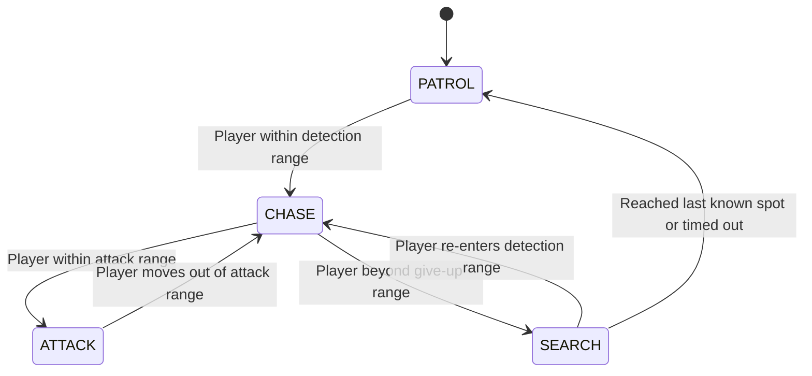
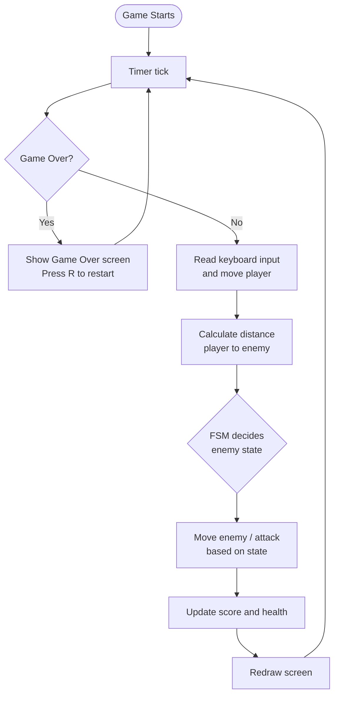

<div align="center">

# 🛡️ SentinelAI – FSM Enemy Game

### Intelligent Enemy Behavior System Using Finite State Machines


*A 2D Java game where an enemy patrols, chases, attacks, and searches, driven entirely by a Finite State Machine. Built with 100% pure Java, no external libraries.*

</div>

---

## 📑 Table of Contents

- [About the Project](#-about-the-project)
- [Features](#-features)
- [How the AI Works](#-how-the-ai-works)
- [Game Loop](#-game-loop)
- [Game Controls](#-game-controls)
- [Gameplay Rules](#-gameplay-rules)
- [Tunable Parameters](#-tunable-parameters)
- [How to Run](#-how-to-run)
- [Project Structure](#-project-structure)
- [Concepts Demonstrated](#-concepts-demonstrated)
- [Roadmap](#-roadmap)
- [Author](#-author)

---

## 📖 About the Project

Most beginner games use enemies that stand still or chase blindly. **SentinelAI** shows how a game character can feel *intelligent* using a classic AI technique, the **Finite State Machine (FSM)**.

The enemy (the colored square) always exists in exactly **one of four states** and switches between them depending on how far the player (the blue square) is. Every state has its own color and on-screen label, so you can *watch* the AI make decisions in real time.

<!--
📸 ADD A SCREENSHOT / GIF HERE
1. Create a folder named "screenshots" in your repo
2. Upload your image (e.g. gameplay.png)
3. Replace this comment with:  
-->

---

## ✨ Features

| Feature | Description |
|---|---|
| 🧠 **4-State Enemy AI** | Patrol, Chase, Attack, and Search behaviors |
| 📏 **Distance-Based Detection** | Euclidean distance checked every frame against detection, attack, and give-up ranges |
| 🎨 **Visual State Feedback** | Enemy changes color and shows a text label for its current state |
| ❤️ **Health System** | Player health drops when the enemy attacks |
| 🏆 **Score System** | Score increases the longer you survive |
| 💀 **Game Over and Restart** | Game freezes at zero health and shows your final score; press **R** to restart |
| ⚡ **Smooth 60 FPS Loop** | Swing `Timer` drives updates and rendering |
| 📦 **Zero Dependencies** | Runs on the standard Java library only |

---

## 🧠 How the AI Works

### Enemy States

| State | Color | Behavior | Switches To |
|---|---|---|---|
| 🟢 **PATROL** | Green | Walks back and forth along a fixed path | **CHASE** when the player enters detection range |
| 🟠 **CHASE** | Orange | Moves directly toward the player at higher speed | **ATTACK** when very close, or **SEARCH** if the player gets too far |
| 🔴 **ATTACK** | Red | Stops and damages the player (with a cooldown) | **CHASE** if the player moves away |
| 🟡 **SEARCH** | Yellow | Walks to the player's *last known position* | **CHASE** if the player is spotted again, or **PATROL** after reaching the spot / timing out |

### State Transition Diagram



---

## 🔄 Game Loop

Every ~16 ms (about 60 times per second) the game runs this cycle:



---

## 🎮 Game Controls

| Key | Action |
|---|---|
| `W` / `↑` | Move up |
| `S` / `↓` | Move down |
| `A` / `←` | Move left |
| `D` / `→` | Move right |
| `R` | Restart (after Game Over) |

---

## 📋 Gameplay Rules

| Element | Rule |
|---|---|
| 🔵 **Player** | Blue square, moves freely inside the window |
| 🔴 **Enemy** | Switches color and behavior depending on its state |
| ⚪ **Faint circle** | Shows the enemy's detection range |
| ❤️ **Health** | Starts at 100 and drops each time the enemy attacks |
| 🏆 **Score** | Grows while you stay alive |
| 💀 **Game Over** | Health reaches 0 |

> **Tip:** Run toward the enemy to trigger CHASE, get close to see ATTACK, then sprint away to watch it switch to SEARCH before giving up.

---

## ⚙️ Tunable Parameters

All behavior values are constants at the top of the code, so you can experiment easily.

| Parameter | Value | Purpose |
|---|---|---|
| Detection range | 220 px | Distance at which the enemy notices the player |
| Attack range | 40 px | Distance at which the enemy attacks |
| Give-up range | 320 px | Distance at which the enemy loses the player |
| Search timeout | ~2 seconds | How long the enemy searches before returning to patrol |
| Frame rate | ~60 FPS | Game loop speed (16 ms timer) |
| Window size | 900 × 600 px | Game area |

---

## 🚀 How to Run

### Prerequisite
Java **JDK 17 or higher**. Check with:
```bash
java -version
```

### Option 1: Run the JAR (easiest)
Double-click **`SmartEnemyGame.jar`**, or run from a terminal:
```bash
java -jar SmartEnemyGame.jar
```

### Option 2: Compile from source
```bash
javac SmartEnemyGame.java
java SmartEnemyGame
```

### Option 3: Use an IDE
Open `SmartEnemyGame.java` in **VS Code** (with the *Extension Pack for Java*) or **Eclipse** and click **Run**.

---

## 📁 Project Structure

```
SentinelAI-FSM-Game/
├── SmartEnemyGame.java    # Complete game source code
├── SmartEnemyGame.jar     # Runnable packaged application
├── screenshots/           # Gameplay images (optional)
└── README.md              # Project documentation
```

---

## 🎓 Concepts Demonstrated

| Area | Concept | Where it appears |
|---|---|---|
| **Artificial Intelligence** | Finite State Machine | Enemy behavior switching |
| **Object-Oriented Programming** | `enum` for states, encapsulation, modular methods | `State` enum, separate update / render methods |
| **Data Structures** | `HashSet` for tracking pressed keys | Keyboard input handling |
| **Mathematics** | Euclidean distance formula | Player-enemy detection |
| **Event-Driven Programming** | `KeyListener`, `ActionListener` | Input and game loop |
| **Real-Time Rendering** | `Graphics2D`, repaint cycle | Drawing player, enemy, and HUD |

---

## 🗺️ Roadmap

- [x] Player movement with keyboard input
- [x] 4-state enemy FSM (Patrol, Chase, Attack, Search)
- [x] Distance-based detection and visual state indicators
- [x] Health and score system with Game Over and Restart
- [x] Packaged as a runnable JAR
- [ ] Multiple enemies with independent state machines
- [ ] Obstacle-aware pathfinding (A\*)
- [ ] Sprite graphics and animations
- [ ] Sound effects
- [ ] Additional states (Flee, Alert nearby enemies)

---

## 👨‍💻 Author

**Yokesh S K**
2nd Year B.E. Computer Science and Engineering
KIT – Kalaignarkarunanidhi Institute of Technology

---

<div align="center">

⭐ If you found this project helpful, consider giving it a star!

</div>
